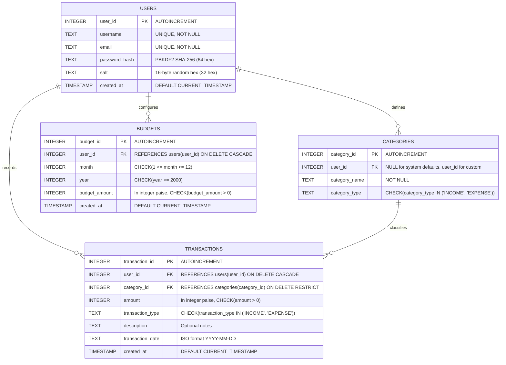

# Personal Expense Tracker

**MCA 3rd Year College Minor Project**  
*Technology Stack: Core Python 3, SQLite3, Standard Library, HTML5, Modern CSS, Vanilla JavaScript*

---

## ⚡ Quick Reference: Run Commands Cheat Sheet

Run all commands from the project root directory:
```bash
cd "/Users/nitinkumar/Developer/Web_Project/Personal Expense Tracker"
```

| Task | Command | What It Does |
| :--- | :--- | :--- |
| **Run Terminal CLI Interface** | `python3 main.py` | Launches the interactive terminal menu with ASCII tables, prompts, and validations. |
| **Run Modern Web Dashboard** | `python3 web_app.py` | Starts the built-in Core Python HTTP web server at [http://localhost:8000](http://localhost:8000). |
| **Open Web App in Browser** | `open http://localhost:8000` | Opens the web dashboard in your default browser (Chrome, Safari, Firefox, Edge). |
| **Run Automated Unit Tests** | `python3 -m unittest discover -s tests -p "test_*.py" -v` | Runs all 15 automated unit test cases verifying authentication, isolation, budgets, and exports. |
| **Seed Demo Data** | `python3 seed_data.py` | Seeds account `demo_user` / `Password123` with realistic multi-category income, expenses, and budget alerts. |
| **View Exported CSVs** | `open exports/` | Opens the CSV exports folder in macOS Finder to open statements in Excel or Numbers. |
| **Inspect SQLite Database** | `open database/` | Opens the database directory containing `expense_tracker.db` in macOS Finder. |

---

## 1. Project Overview & Abstract

The **Personal Expense Tracker** is a comprehensive, production-grade financial management software system engineered for an **MCA 3rd Year College Minor Project**. 

Built strictly with **Core Python 3** and an embedded **SQLite3** relational database, the project features two user interfaces:
1. An **Interactive Terminal CLI** with styled ASCII tables, input validation, and guided prompts.
2. A **Modern Responsive Web Dashboard** built with semantic HTML5, modern CSS (with Dark/Light mode and mobile responsiveness), and vanilla JavaScript—served entirely by Python's built-in `http.server` with **zero external dependencies** (`pip install` is never needed).

### Key Architectural Highlights
- **100% Core Python & Built-in Modules**: Strictly avoids heavyweight web frameworks (no Django, Flask, FastAPI) and third-party libraries (no Pandas, NumPy, SQLAlchemy). All logic is written in pure Python standard library (`sqlite3`, `hashlib`, `http.server`, `csv`, `datetime`, `re`, `decimal`, `unittest`).
- **Precision-Safe Financial Computations**: All currency values are stored as **integer paise** (1 Rupee = 100 paise) using `decimal.Decimal` string parsing, completely eliminating IEEE-754 floating-point rounding errors (such as `0.1 + 0.2 = 0.30000000000000004`).
- **Enterprise-Grade Password Security**: Password hashing implemented using **PBKDF2 HMAC SHA-256** with cryptographically secure random per-user salts (`os.urandom(16)`, 100,000 iterations) and constant-time digest comparison (`hmac.compare_digest`) to prevent timing attacks.
- **Strict Multi-User Data Isolation**: SQLite foreign keys (`PRAGMA foreign_keys = ON;`) and parameterized queries ensure complete data privacy between registered accounts.
- **Dark & Light Mode**: Built-in instant theme switcher respecting OS system preferences with zero Flash of Unstyled Content (FOUC).
- **Mobile Responsive**: Finger-friendly touch targets (>=44px), dynamic viewport units (`100dvh`), notch safe-area padding, and horizontal scroll containment.

---

## 2. Feature-Based Architecture & Folder Structure

The project employs a modern **Feature-Based Architecture** (also known as Vertical Slice Architecture or Packaging-by-Feature). Instead of scattering logic across disconnected horizontal layers, code is grouped by domain features (`features/auth`, `features/income`, `features/expenses`, `features/budget`, etc.). Each feature encapsulates its own models, services, and domain logic, maximizing cohesion and maintainability.

```
Personal Expense Tracker/
│
├── main.py                     # Terminal CLI interface controller & menu router
├── web_app.py                  # Core Python HTTP server (built-in http.server, zero external packages)
├── database.py                 # SQLite3 database connection manager, schema engine, & transactions
├── config.py                   # Global constants, paths, default categories, and thresholds
├── seed_data.py                # Standalone demonstration data seeder (demo_user / Password123)
├── requirements.txt            # Dependency specification (standard library only)
├── README.md                   # Complete academic and technical project documentation
│
├── features/                   # Feature-Based Domain Architecture (Vertical Slices)
│   ├── __init__.py
│   ├── auth/                   # Feature 1: User Authentication & Security
│   │   ├── __init__.py
│   │   ├── models.py           # User entity model
│   │   └── service.py          # Registration, login, PBKDF2 hashing, sessions
│   ├── income/                 # Feature 2: Income Management
│   │   ├── __init__.py
│   │   └── service.py          # Income recording, history, updates, filters
│   ├── expenses/               # Feature 3: Expense Management & Budget Monitoring
│   │   ├── __init__.py
│   │   └── service.py          # Expense tracking, budget threshold checks
│   ├── categories/             # Feature 4: Category Management
│   │   ├── __init__.py
│   │   └── service.py          # System defaults & custom categories
│   ├── budget/                 # Feature 5: Monthly Budget Management
│   │   ├── __init__.py
│   │   └── service.py          # Spending limits, calculations, 80%/100% alerts
│   ├── dashboard/              # Feature 6: Real-time Analytics & Financial KPIs
│   │   ├── __init__.py
│   │   └── service.py          # High-level KPIs, balances, monthly savings
│   └── reports/                # Feature 7: Analytical Statements & Data Exports
│       ├── __init__.py
│       └── service.py          # Daily, weekly, monthly, yearly reports, CSV export
│
├── web/                        # Modern Web Frontend (HTML5, Modern CSS, Vanilla JS)
│   ├── index.html              # Responsive single-page dashboard with native <dialog> modals
│   ├── styles.css              # Modern CSS (variables, light-dark(), touch targets, mobile rules)
│   └── app.js                  # Client logic, theme toggle, and REST JSON API communications
│
├── utils/                      # Shared Cross-Cutting Utilities & Validators
│   ├── __init__.py
│   ├── validators.py           # Regex, length, date & high-precision amount validators
│   └── helpers.py              # Currency formatting, ASCII table printer, console helpers
│
├── modules/                    # Backwards Compatibility Layer (Facades mapping to features)
│
├── database/                   # Database Storage Folder
│   └── expense_tracker.db      # SQLite3 relational database file (auto-generated)
│
├── exports/                    # CSV Export Target Directory
│   └── *.csv                   # Timestamped exported spreadsheets
│
└── tests/                      # Automated Unit Test Suite
    ├── __init__.py
    └── test_tracker.py         # 15 comprehensive unit tests (Python unittest)
```

---

## 3. Database Schema & Entity-Relationship (ER) Design

The application utilizes **SQLite3** with foreign key constraints enabled (`PRAGMA foreign_keys = ON;`) to preserve relational integrity.

### Mermaid Entity-Relationship Diagram



### Table Specifications

1. **`users` Table**:
   - `user_id`: Primary Key, auto-incrementing integer.
   - `username`: Alphanumeric, unique identifier (3-30 characters).
   - `email`: Normalized unique email address.
   - `password_hash`: 64-character hexadecimal SHA-256 hash generated via PBKDF2.
   - `salt`: 32-character hexadecimal cryptographically secure random salt.
   - `created_at`: Registration timestamp.

2. **`categories` Table**:
   - `category_id`: Primary Key.
   - `user_id`: Foreign key referencing `users.user_id`. Set to `NULL` for default system categories available to all users; contains a valid `user_id` for custom categories.
   - `category_name`: Name of category (e.g. *Food*, *Travel*, *Salary*, *Freelancing*).
   - `category_type`: Constraint check `CHECK(category_type IN ('INCOME', 'EXPENSE'))`.
   - `UNIQUE(user_id, category_name, category_type)`: Prevents duplicate category names per user.

3. **`transactions` Table**:
   - `transaction_id`: Primary Key.
   - `user_id`: Foreign key with `ON DELETE CASCADE`.
   - `category_id`: Foreign key with `ON DELETE RESTRICT` to prevent orphaned records.
   - `amount`: Precision integer paise (`₹ 100.50` = `10050` paise).
   - `transaction_type`: `INCOME` or `EXPENSE`.
   - `description`: Text notes regarding the transaction.
   - `transaction_date`: String in ISO-8601 `YYYY-MM-DD` format.
   - Indices on `(user_id, transaction_date)` and `(user_id, transaction_type)` for query optimization.

4. **`budgets` Table**:
   - `budget_id`: Primary Key.
   - `user_id`: Foreign key referencing `users.user_id`.
   - `month`: Integer (1 to 12).
   - `year`: Integer (e.g. 2026).
   - `budget_amount`: Budget limit in integer paise.
   - `UNIQUE(user_id, month, year)`: Ensures exactly one budget entry per user per month.

---

## 4. Module-by-Module Walkthrough

### 1. User Authentication (`modules/authentication.py`)
- **Registration**: Enforces username regex (`^[a-zA-Z0-9_]+$`, 3-30 chars), email RFC regex, and password length (min 6 chars). Prevents duplicate usernames and emails.
- **Hashing**: Generates a 16-byte random salt (`os.urandom(16)`) and hashes with `hashlib.pbkdf2_hmac('sha256', password, salt, 100000)`.
- **Login**: Re-computes hash with stored salt and verifies via `hmac.compare_digest` to prevent side-channel timing attacks.
- **Change Password**: Validates existing password before applying the new salted hash.

### 2. Income Management (`modules/income.py`)
- Record earnings categorized under *Salary*, *Freelancing*, *Business*, *Investment*, or custom categories.
- Filters by date range, keyword search in descriptions/categories, transaction updates, and safe deletion.

### 3. Expense Management (`modules/expenses.py`)
- Record expenditures categorized under *Food*, *Travel*, *Shopping*, *Education*, *Entertainment*, *Medical*, *Bills*, or custom categories.
- Positive amount validation.
- **Real-Time Budget Check**: Automatically calculates month-to-date spending and generates warnings if **80% threshold** or **100% budget overdraft** is reached.

### 4. Category Management (`modules/categories.py`)
- Pre-seeds 13 default categories (5 income, 8 expense).
- Allows users to create custom categories.
- Protects system default categories from deletion.
- Prevents deletion of custom categories that are linked to existing transactions (`ON DELETE RESTRICT`).

### 5. Budget Management (`modules/budget.py`)
- Sets or updates monthly spending limits per user.
- Employs SQLite's `INSERT ... ON CONFLICT(user_id, month, year) DO UPDATE` to prevent duplicate monthly budgets.
- Calculates amount spent, remaining budget balance, and percentage utilized.

### 6. Financial Dashboard (`modules/dashboard.py`)
- Aggregates Lifetime Total Income, Lifetime Total Expenses, and Net Balance (`Income - Expenses`).
- Calculates Current Month Income, Expenses, and Net Monthly Savings.
- Identifies Highest and Lowest individual expense records with category, amount, and date.
- Computes category-wise spending totals and percentage distributions.

### 7. Financial Reports & CSV Export (`modules/reports.py`)
- **Daily Report**: Breakdown of transactions on a specific date.
- **Weekly Report**: 7-day matrix of daily income, expense, and net values.
- **Monthly Report**: Comprehensive statement for any chosen month and year with budget performance.
- **Yearly Report**: 12-month annual financial matrix.
- **Category-wise Report**: Spending percentages across all categories.
- **Income vs Expense Report**: Comparative savings rate analysis (`Savings / Income * 100`).
- **CSV Export**: Uses Python's built-in `csv` module to generate formatted spreadsheets into the `exports/` directory.

### 8. Utilities & Helpers (`utils/validators.py`, `utils/helpers.py`)
- `parse_amount_to_paise`: Uses `decimal.Decimal` to convert currency input to integer paise without float errors.
- `format_currency`: Formats integer paise into `₹ X,XX,XXX.XX` representation.
- `print_table`: Dynamic column-width ASCII table printer for the terminal CLI.

---

## 5. Execution Instructions

### Prerequisites
- Python 3.8 or higher installed on your computer.
- Standard terminal (macOS Terminal, iTerm, Linux Bash, Windows PowerShell/Command Prompt).

### How to Run the Terminal CLI Interface:
```bash
python3 main.py
```
1. In the pre-login menu, choose **Option 3** (`Seed Sample Demo Data`).
2. Choose **Option 2** (`Login to Account`), enter `demo_user` and `Password123`.
3. Use options 1 to 10 to add transactions, view budgets, inspect summaries, and export CSV files.

### How to Run the Modern Web Dashboard:
```bash
python3 web_app.py
```
1. Open your web browser and navigate to: **`http://localhost:8000`**
2. The dashboard will display all income, expenses, balance cards, budget status, and transactions.
3. Click **Theme** in the top navigation bar to toggle between **Dark** and **Light** modes.
4. Click **+ Add Income** or **+ Add Expense** to record new transactions via modal dialogs.
5. Click **Download CSV** to download the spreadsheet directly to your machine.

---

## 6. Demonstration Data (`demo_user`)

The project includes a dedicated data seeder (`seed_data.py`) that pre-configures a demonstration account:
- **Username**: `demo_user`
- **Password**: `Password123`
- **Pre-Loaded Records**:
  - **Incomes**:
    - Salary: ₹ 75,000.00
    - Freelancing: ₹ 22,500.00
    - Investment: ₹ 4,200.50
    - Other: ₹ 3,000.00
  - **Expenses**:
    - Apartment Rent (*Bills*): ₹ 18,500.00
    - Supermarket (*Food*): ₹ 6,450.00
    - Fuel & Metro (*Travel*): ₹ 3,200.00
    - Electricity (*Bills*): ₹ 2,400.00
    - Subscriptions (*Entertainment*): ₹ 1,499.00
    - Formal Attire (*Shopping*): ₹ 4,850.50
    - Dental Care (*Medical*): ₹ 1,800.00
    - Cloud Exam (*Education*): ₹ 3,500.00
    - Gym Fee (*Gym & Fitness*): ₹ 2,500.00
  - **Monthly Budget**:
    - Set to **₹ 50,000.00** with total spending at **₹ 44,699.50** (**89.4% used**), demonstrating the **80% Budget Warning Alert**.

---

## 7. Automated Unit Tests

The test suite in `tests/test_tracker.py` contains **15 automated unit tests** built using Python's standard `unittest` framework:

```bash
python3 -m unittest discover -s tests -p "test_*.py" -v
```

### Test Results:
```text
test_budget_upsert_and_calculations (test_tracker.TestPersonalExpenseTracker) ... ok
test_change_password (test_tracker.TestPersonalExpenseTracker) ... ok
test_custom_category_creation_and_deletion (test_tracker.TestPersonalExpenseTracker) ... ok
test_dashboard_calculations (test_tracker.TestPersonalExpenseTracker) ... ok
test_database_persistence_across_reconnect (test_tracker.TestPersonalExpenseTracker) ... ok
test_default_categories_seeded (test_tracker.TestPersonalExpenseTracker) ... ok
test_expense_crud_and_budget_warnings (test_tracker.TestPersonalExpenseTracker) ... ok
test_income_crud (test_tracker.TestPersonalExpenseTracker) ... ok
test_reports_and_csv_export (test_tracker.TestPersonalExpenseTracker) ... ok
test_strict_user_data_isolation (test_tracker.TestPersonalExpenseTracker) ... ok
test_user_login_invalid_credentials (test_tracker.TestPersonalExpenseTracker) ... ok
test_user_login_success (test_tracker.TestPersonalExpenseTracker) ... ok
test_user_registration_duplicate_email (test_tracker.TestPersonalExpenseTracker) ... ok
test_user_registration_duplicate_username (test_tracker.TestPersonalExpenseTracker) ... ok
test_validators (test_tracker.TestPersonalExpenseTracker) ... ok

----------------------------------------------------------------------
Ran 15 tests in 0.220s

OK
```

---

## 8. Viva Voce Questions & Answers (Examiner Preparation)

### Q1: Why did you choose SQLite3 instead of MySQL or PostgreSQL?
> **Answer**: SQLite3 is an embedded, serverless, zero-configuration relational database engine built directly into the Python standard library. It persists data in a single cross-platform file (`expense_tracker.db`). For desktop and standalone command-line applications, SQLite3 provides full ACID compliance, high throughput, and zero networking or server installation overhead.

### Q2: Why is financial money stored in integer paise instead of float?
> **Answer**: In standard floating-point representation (IEEE-754), binary fractions cannot accurately represent base-10 decimals like `0.1` or `0.2` (e.g. `0.1 + 0.2 = 0.30000000000000004`). In banking and finance, rounding inaccuracies compound and cause balance discrepancies. Storing amounts as integer paise (`1 Rupee = 100 paise`) guarantees that all arithmetic operations are 100% mathematically exact. Values are converted back to Rupees only for display and CSV export.

### Q3: How is password security implemented in your project?
> **Answer**: Passwords are never stored in plain text. We use the standard library `hashlib.pbkdf2_hmac` algorithm with SHA-256, 100,000 iterations, and a unique 16-byte cryptographically secure random salt generated via `os.urandom(16)`. During authentication, we compute the hash of the entered password with the user's stored salt and verify it using `hmac.compare_digest()`, which prevents timing attacks.

### Q4: How is user data isolation guaranteed?
> **Answer**: All transactional and budget tables (`transactions`, `budgets`, `categories`) store a `user_id` foreign key referencing the `users` table. Every SQL query filters strictly by the authenticated `user_id` (e.g. `WHERE user_id = ?`). Parameterized queries prevent SQL injection, and a user cannot view, edit, or delete records belonging to any other user.

### Q5: How do you prevent duplicate monthly budgets?
> **Answer**: The `budgets` table defines a compound unique constraint: `UNIQUE(user_id, month, year)`. When setting a budget, the application uses SQLite's `INSERT ... ON CONFLICT(user_id, month, year) DO UPDATE SET budget_amount = excluded.budget_amount;` syntax. This performs an upsert, seamlessly updating the existing budget without creating duplicate records.

### Q6: How does the web server function without Flask or Django?
> **Answer**: We utilized Python's built-in `http.server.HTTPServer` and `BaseHTTPRequestHandler`. By subclassing `BaseHTTPRequestHandler`, we override `do_GET`, `do_POST`, and `do_DELETE` to handle static asset delivery (`index.html`, `styles.css`, `app.js`) and REST JSON API endpoints (`/api/summary`, `/api/income`, `/api/expense`, `/api/budget`). This keeps the application 100% compliant with Core Python requirements while delivering a modern web experience.

---

## 9. Author & Project Metadata

- **Course**: Master of Computer Applications (MCA)
- **Year / Semester**: 3rd Year / Minor Project
- **Project Title**: Personal Expense Tracker
- **Language**: Python 3 (3.8+)
- **Database**: SQLite3
- **Test Suite**: Python `unittest` (15 Automated Unit Tests)
